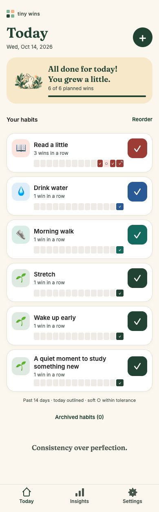
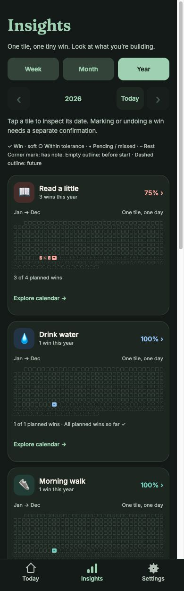
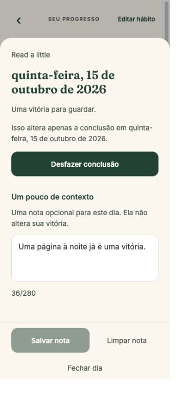

# Tiny Wins 🌱

**Small steps. Big changes.**

A gentle habit tracker that turns everyday effort into a wall of little victories. Read a page, take a walk, drink some water — fill a tile and watch your progress grow.

Built for **consistency over perfection**. Your past wins stay yours, even when a streak breaks.

[Try it locally](#try-it-locally) · [What you can do](#what-you-can-do-today) · [Roadmap](#whats-next) · [Development](#development)

## A little look inside

<table>
  <tr>
    <th>Today</th>
    <th>Insights · dark mode</th>
    <th>A note · Português (Brasil)</th>
  </tr>
  <tr>
    <td valign="top" align="center"><a href="docs/screenshots/readme-today-light-390.jpg"></a></td>
    <td valign="top" align="center"><a href="docs/screenshots/readme-insights-dark-390.jpg"></a></td>
    <td valign="top" align="center"><a href="docs/screenshots/language-day-note-pt-360.jpg"></a></td>
  </tr>
  <tr>
    <td align="center">Your next small win, one tap away.</td>
    <td align="center">A whole year of effort, one tile at a time.</td>
    <td align="center">Your words stay yours in either interface language.</td>
  </tr>
</table>

Actual browser development previews with example habits. Today and Insights were captured on October 14, 2026 for the visual refresh; the Portuguese note was captured on October 15 for the language review. Click a screenshot for the full-size view.

## What you can do today

| Make it yours                                              | See what you're building                                            | Keep your history                                                   |
| ---------------------------------------------------------- | ------------------------------------------------------------------- | ------------------------------------------------------------------- |
| Create and edit habits with names, icons and colors        | Complete or undo today's habit in one tap                           | Keep habits, wins and notes in local SQLite storage                 |
| Choose every day or specific weekdays                      | See exactly **14 calendar days** on each Today row                  | Inspect a date and deliberately edit a past completion              |
| Reorder habits, or archive and restore them                | Explore each habit's **week, month and year** victory wall          | Add a short note to a habit/date without changing its completion    |
| Configure **0–7 days of streak flexibility**               | Track current/best streaks, total wins and eligible-day consistency | Export JSON backups and restore missing records after review        |
| Choose light/dark appearance and Sunday/Monday week starts | Get immediate visual feedback, including an all-done banner         | Preserve original calendar dates when schedules or timezones change |

Choose **System, English or Português (Brasil)** in Settings to change the interface language. Your habit names and notes stay exactly as you wrote them, and the choice is saved on this device. In the browser preview, System follows the browser's language. [See the language choices](docs/screenshots/language-settings-pt-390.jpg); the complete ten-flow iPhone acceptance is recorded in [task 017](.harness/tasks/017-interface-languages.md).

Creating a habit? Open **Need an idea?** for three optional starting points: read one page, drink water or take a short walk. Names follow the interface language and stay fully editable, alongside icons and colors. Choosing an idea saves nothing; your chosen days and streak flexibility stay intact. [See the Portuguese editor](docs/screenshots/starter-ideas-pt-390.png).

Schedule and flexibility changes begin tomorrow, preserving earlier history. Notes support up to 280 characters and remain readable on archived habits. Backups include notes and flexibility settings; older v1/v2 files remain importable, and restore keeps existing local records.

### A streak with room to breathe

Read on Sunday, miss Monday, read again on Tuesday. With one day of flexibility, your sequence continues with **two actual wins**. Monday gets a soft **○** tile to recognize the breathing room.

Each tile represents one calendar day. Completed days get **✓**; tolerated gaps get **○**; rest days stay distinct. Only completed days count as wins or toward consistency. An unfinished today can stay pending while you work on it.

### Your habits stay with you

The core app works offline and stores data on your device, without an account or telemetry. Export a backup when you want to keep another copy or move devices. Light and dark themes share the same habit identities, and completion feedback respects reduced motion.

## What's next

Interface languages and editable habit suggestions are implemented. While Apple enrollment is with support, the next approved features are flexible weekly goals → session timer. Starter-idea native acceptance is tracked in [task 018](.harness/tasks/018-starter-habits.md). First-release preparation continues alongside this sequence. Start with the [Portuguese App Store guide](docs/release/APP_STORE_GUIDE.md), [release readiness checklist](docs/release/READINESS.md) and [store listing drafts](docs/release/STORE_LISTING.md). The app is not yet ready for submission; security, signed production/device testing, branding and store setup remain open gates.

The [implementation plan](docs/IMPLEMENTATION_PLAN.md) guides these additions. They are planned work, with no promised release dates.

| Direction                               | Planned additions                                                                                            |
| --------------------------------------- | ------------------------------------------------------------------------------------------------------------ |
| **A warmer everyday experience**        | Further cozy visual refinement and optional sounds                                                           |
| **Progress at a glance**                | Home-screen widgets with pending habits, victory tiles and quick check-ins where supported                   |
| **Routines that fit real life**         | Flexible goals such as “walk on three days each week,” plus deliberate pause/skip options                    |
| **A moment to focus**                   | A session stopwatch/countdown that offers a deliberate check-in when you finish                              |
| **A helpful nudge**                     | An optional daily review reminder and configurable per-habit reminders                                       |
| **Optional connections, further ahead** | iCloud synchronization between Apple devices, Todoist completion integration and exploration of Apple Health |

Future integrations need their own platform, privacy and reliability decisions. The core remains a quick binary check-in: one completed habit, one filled tile.

## Try it locally

Use **Node 24 LTS** and npm; the repository includes `.nvmrc`.

```sh
npm ci
npm run preview
```

Open **http://localhost:8090**. Create a habit, mark a win, reload and see it remain. The preview serves a production export; rerun the preview command after source changes to rebuild it.

Keep one Tiny Wins preview tab open at a time. Browser storage belongs to that browser/origin and is separate from native device storage. The Expo SQLite web adapter is alpha; the preview supports development and review. See [ADR-006](docs/adr/006-browser-preview.md).

### Run on a device or simulator

```sh
npm start
```

Use a compatible Expo Go installation, or compile a native development app with the appropriate local toolchain:

```sh
npm run ios
# or
npm run android
```

Native builds require Xcode or the Android SDK and an installed simulator/device. The app needs no backend or environment secrets. Fonts ship with the bundle.

## Development

**React Native + Expo + TypeScript** power the shared iOS/Android interface. **Expo Router** handles navigation; **Expo SQLite + Drizzle** handle local persistence. Calendar dates, schedules and streak rules live in pure TypeScript, behind repository interfaces. **Vitest** checks domain rules and real SQLite persistence; **Maestro** exercises native interactions.

```sh
npm run verify
```

This runs strict types, lint, formatting, deterministic unit tests, real SQLite integration tests and JavaScript exports for iOS, Android and web.

<details>
<summary>Useful commands</summary>

| Command                                   | Purpose                                                                |
| ----------------------------------------- | ---------------------------------------------------------------------- |
| `npm ci`                                  | Install locked dependencies and guarded compatibility/security patches |
| `npm run preview`                         | Build and serve the browser preview                                    |
| `npm start`                               | Start the Expo development server                                      |
| `npm run ios` / `npm run android`         | Compile and run a native development app                               |
| `npm run typecheck`                       | Check strict TypeScript                                                |
| `npm run lint`                            | Run Expo ESLint                                                        |
| `npm run format` / `npm run format:check` | Apply or check Prettier formatting                                     |
| `npm run test:unit`                       | Test calendar and domain rules deterministically                       |
| `npm run test:integration`                | Test real SQLite migrations, writes and close/reopen                   |
| `npm run build`                           | Export production JavaScript and assets for all three platforms        |
| `npm run test:e2e`                        | Run the first-win Maestro flow on an installed native app              |
| `npm run security`                        | Audit dependencies; high/critical findings fail                        |

JavaScript exports are separate from compiled, signed native apps. Maestro clears the test app's data; use a dedicated test device. Expo Go does not use the app's native identifier.

</details>

### Builds, checks and release status

[GitHub Actions](https://github.com/squiter/tiny-wins/actions) runs verification, a separate dependency audit, Android debug builds, iOS simulator builds and native smoke flows. Debug artifacts require the Expo development server and expire after seven days.

Tiny Wins is **in active development**, with iOS as the first release target and a shared Android codebase. Native accessibility, enlarged-text review, file-dialog acceptance and Android runtime validation remain release work. Check the [delivery report](docs/DELIVERY_REPORT.md) and [harness tasks](.harness/tasks) for the evidence and open gates of each slice.

The raw dependency audit retains upstream alerts. A temporary, owner-approved [tooling policy](docs/adr/020-proposed-patched-dependency-audit-policy.md) checks exact patched sources, known advisories and expiration; unknown findings still block CI. Final signed-build dependency inspection remains a release gate. Temporary mitigations and remaining findings are recorded in the [CI/security report](docs/CI_SECURITY_REPORT.md); findings are not suppressed. SQLite web compatibility patches are documented in [ADR-008](docs/adr/008-sqlite-web-bridge-fix.md).

The official App Store release is planned as a **one-time paid download**, with no in-app payments or subscription. Store publication, final identifiers, branding and pricing are still pending. An open-source license has not yet been selected.

`npm run security:bundle` exports production iOS JS and rejects affected tooling modules.

`npm run security:policy` evaluates the temporary patched-tooling policy and retains the unmodified raw audit report/result. A policy pass is not a clean raw audit.

## Explore the project

- [Implementation plan](docs/IMPLEMENTATION_PLAN.md) — product direction and roadmap.
- [Design system](docs/DESIGN_SYSTEM.md) and [inspirations](docs/inspirations) — the visual direction.
- [Architecture](docs/ARCHITECTURE.md) and [decision records](docs/adr) — storage, dates, backups and platform boundaries.
- [Delivery report](docs/DELIVERY_REPORT.md) — actual validation and remaining work.
- [Contributing](CONTRIBUTING.md), [agent contract](AGENTS.md) and [harness checks](.harness/checks.md) — how changes are scoped and verified.

**One small win is a good place to start.**
